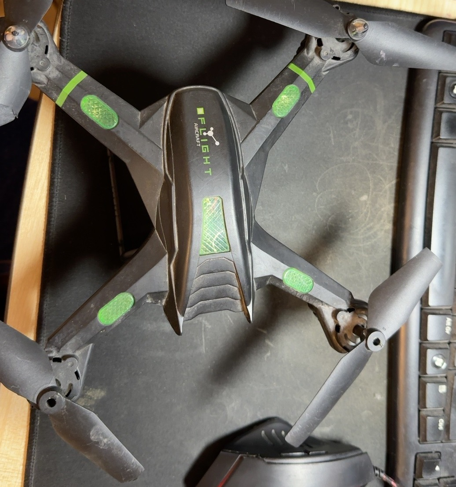
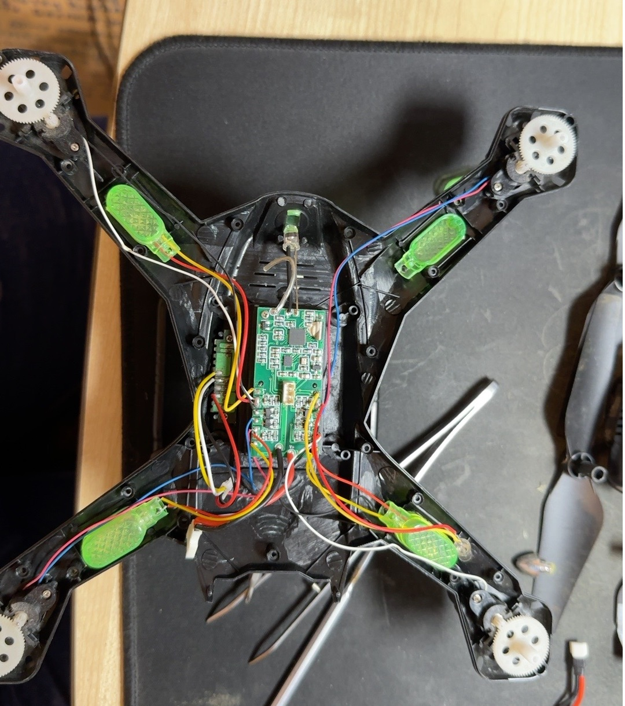
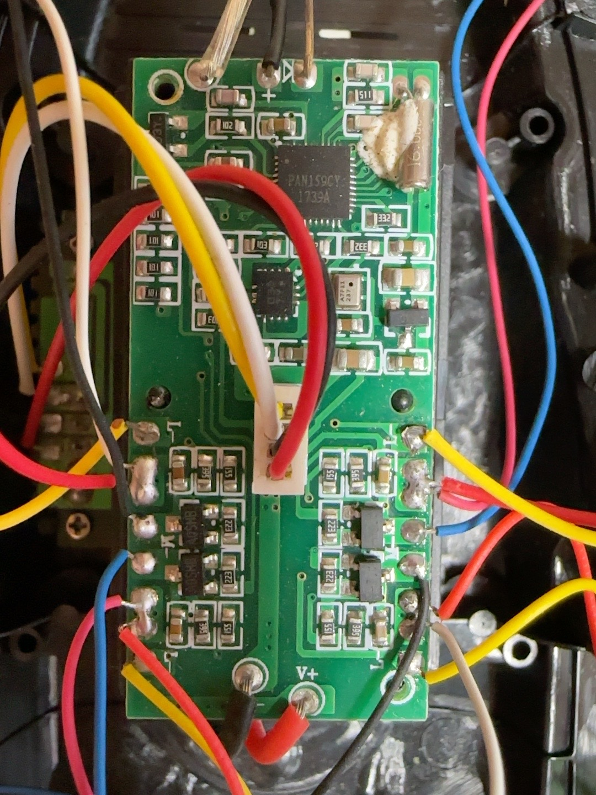
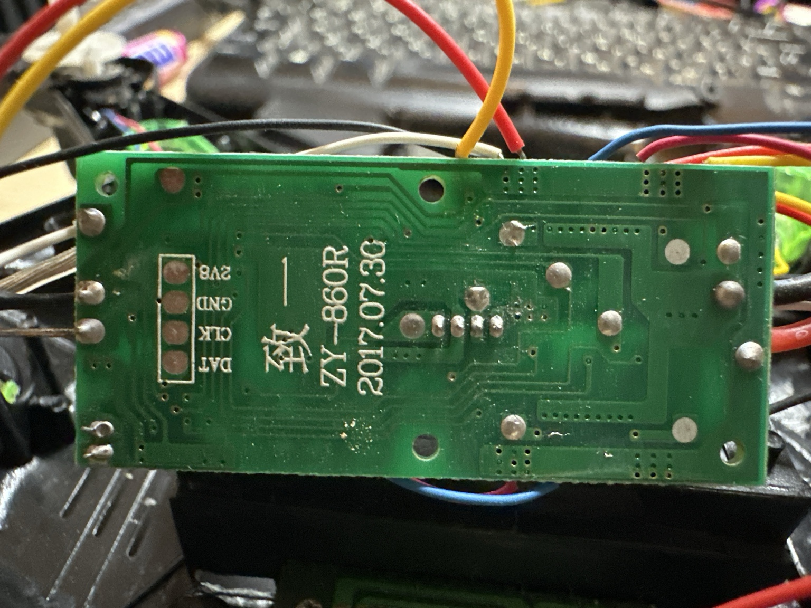
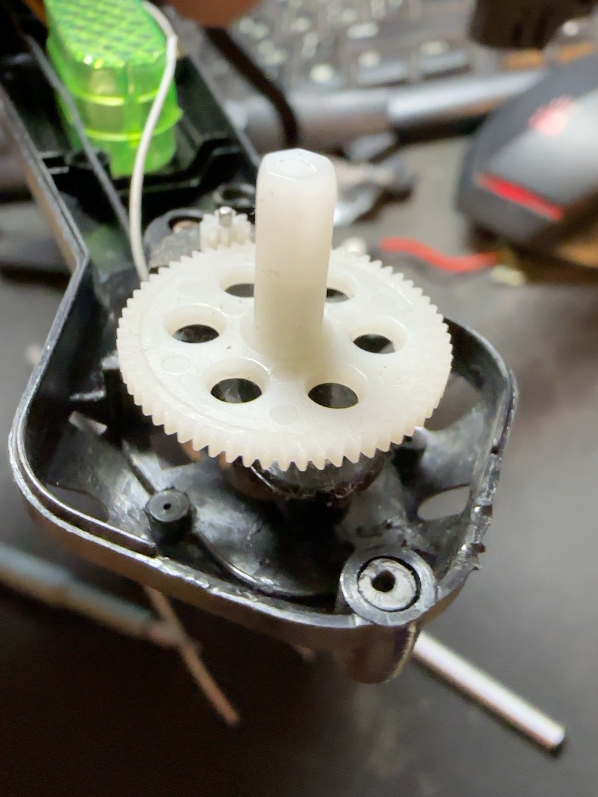
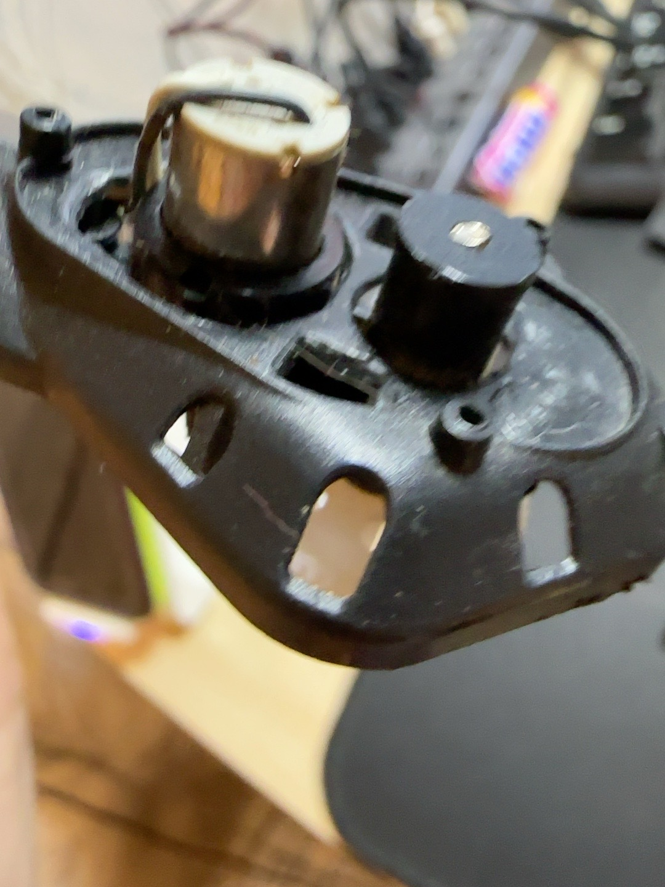
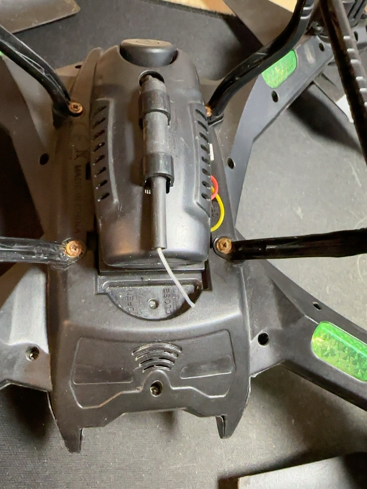
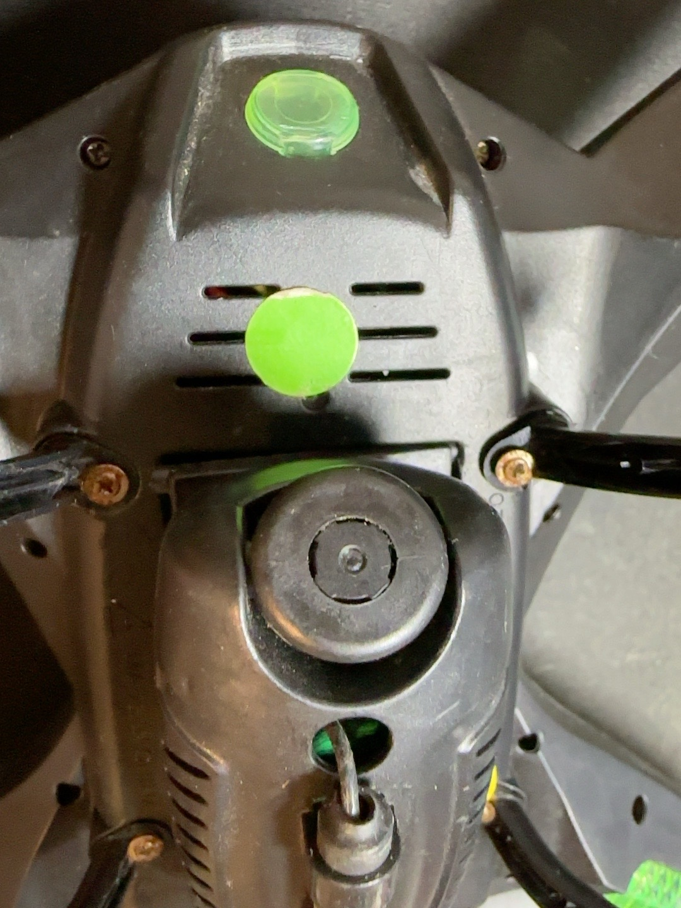
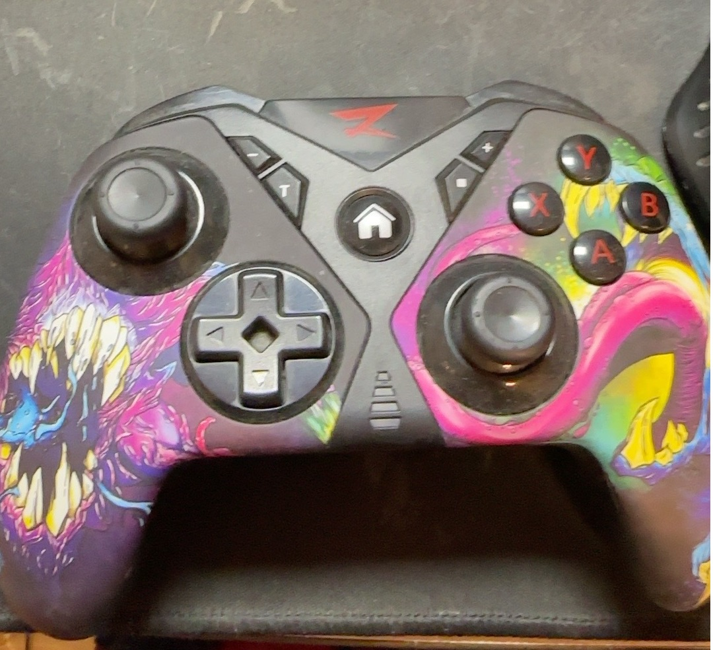

# iQuadro 🚁 — GoSHa Drone

### Вторая жизнь игрушечного квадрокоптера без пульта: ремонт, реверс-инжиниринг, ESP32 и Bluetooth-геймпад

> **Дневник разработчика GoSHa — 7 ноября 2026**  
> Статус: **геймпад → Bluetooth → ESP32 работает**; передача команд на **сам квадрокоптер ещё НЕ реализована**.
>
> Квадрокоптер приехал без пульта, с аккумулятором 0,18 В, да ещё и подозрительно надутым. По законам жанра нужно было купить новый. Но у разработчика GoSHa более интересные законы: разобрать, понять, измерить и попробовать собрать свой пульт. В конце концов, зачем покупать новый дрон, когда можно создать себе научно-техническую проблему?

**iQuadro** — проект восстановления и модернизации квадрокоптера на штатной плате **ZY-860R**, с сохранением двигателей, редукторов и по возможности системы стабилизации. В качестве будущего пульта рассматривается **ARDOR GAMING Vigour → ESP32-WROOM-32 → nRF24L01+ → заводская плата**. Последние два звена пока являются *планом*, а не подтверждённой работоспособностью.

**Разработчик:** GoSHa / iXimik  
**Папка проекта Windows:** `E:\quadro`  
**Смежный проект:** [iSmartCar](https://github.com/iXimik/iSmartCar), откуда взят опыт с Bluetooth-геймпадами.

## 📸 Фотогалерея разборки — реальные кадры проекта

Эти **девять оригинальных фотографий** уже находятся в [`photos/`](photos/) и открываются нажатием на миниатюру. Это не картинки из магазина: перед нами именно разобранная игрушка GoSHa. Технические комментарии основаны на видимых деталях; радиопротокол и исправность двигателей ещё не проверены.

| Снаружи | После вскрытия | Основная плата |
|:--:|:--:|:--:|
| [](photos/IMG_35D501A4-B1B3-41E5-A8DD-DAFEC59E4285.jpeg) | [](photos/IMG_5053DC6C-4EBA-4EB8-9C8C-45F61891FB48.jpeg) | [](photos/IMG_515EA5BB-3013-4549-9DA4-D03C2ADAA7AC.jpeg) |
| Корпус и четыре привода | Провода, светодиоды, электроника | Контроллер, обвязка и ключи |

| Обратная сторона платы | Шестерня редуктора | Мотор в луче |
|:--:|:--:|:--:|
| [](photos/IMG_17924557-92C3-48B4-9EEA-6DB59E198053.jpeg) | [](photos/IMG_02CBCBBE-4A2F-4E1B-B041-E95590F19EB7.jpeg) | [](photos/IMG_E6E28FBB-F059-4CB0-B70B-737EDC44C33B.jpeg) |
| ZY-860R, 2017.07.30; 2V8/GND/CLK/DAT | Механический редуктор | Коллекторный привод |

| Нижний модуль | Крупный план модуля | Наш пульт |
|:--:|:--:|:--:|
| [](photos/IMG_0BC5C7FA-C769-46C5-8D17-5FE379E5C843.jpeg) | [](photos/IMG_A3643001-F41B-417B-A3D1-089BB976A80C.jpeg) | [](photos/IMG_A3A11BE3-7CC6-438B-9D95-10409D0E0C08.jpg) |
| Крепление и провод | Назначение уточняется | Switch Pro → ESP32: испытано |

> **Из лабораторного блокнота GoSHa:** «Внутри оказались не инопланетные технологии, а привычная плата, четыре мотора и шестерни. Уже неплохо: теперь понятно, что именно мы собираемся подружить с ESP32. А вот каким радиопротоколом разговаривать с PAN159CY, ещё придётся выяснить».

🔎 **[Подробный разбор всех 9 фотографий с техническими комментариями](docs/PHOTOS.md)**

## 📋 Что сделано

| Этап | Результат |
|---|---|
| Обследование корпуса и разборка | ✅ фото корпуса, платы, камеры/модуля, проводки, редукторов |
| Родная батарея CY 802540H | ✅ Li-Po 1S, 3,7 В, 600 мА·ч |
| Напряжение старой батареи | ✅ ~0,18 В на разъёме, отмечено вздутие; батарея утилизирована |
| Плата защиты старого аккумулятора | ✅ снята, сфотографирована; это **не подтверждённый зарядник** |
| Основная плата | ✅ ZY-860R, маркировка 2017.07.30 |
| Основная микросхема | ✅ на фото читается PAN159CY (назначение прочих чипов требует подтверждения) |
| Двигатели | ✅ 4 коллекторных двигателя через шестерёнчатые редукторы, **пока не запускались** |
| ESP32-WROOM-32 | ✅ ESP32-D0WDQ6, мост CP210x, порт COM3 |
| Arduino CLI / Bluepad32 | ✅ Arduino CLI 1.5.1, пакет esp32-bluepad32 4.1.0 |
| Тестовая прошивка ESP32 | ✅ собрана и успешно загружена, хеш проверен |
| MOBASE G910 | ⚠️ Bluetooth-соединение есть, распознаётся как **Keyboard**, стики не читаются тестом |
| ARDOR GAMING Vigour | ✅ Nintendo/Switch mode → **Model: Switch Pro** |
| Четыре оси Vigour | ✅ LX, LY, RX, RY в пределах примерно −512…+512 |
| Кнопки Vigour | ✅ зарегистрированы битовые маски 0x0100, 0x0001, 0x0002 |
| Радиопротокол квадрокоптера | ⏳ не определён, совместимость с nRF24L01+ / GW008 **не доказана** |
| Стендовое питание и тест двигателей | ⏳ не проводились |
| Полёт с новым пультом | ❌ не проводился |

## 🚁 Железо и проблемы

На обороте основной платы: **ZY-860R / 2017.07.30** и площадки **2V8, GND, CLK, DAT**. Назначение площадок не подтверждено: нельзя подключать их к ESP32 3,3/5 В наугад. На плате видны силовые ключи моторов и несколько микросхем, но точная модель IMU не установлена. Предположительно радиопульт работал на 2,4 ГГц с нестандартным протоколом.

На штатной батарее: **CY 802540H, 3,7 В / 600 мА·ч**. После измерения 0,18 В и обнаружения признаков вздутия ячейку не стали восстанавливать. Кандидат на замену — 1S Li-Po 802540P **600 мА·ч / 25C по заявлению продавца** (необходимо проверить размеры, массу, фактическую токоотдачу, разъём и **полярность**). Большая 18650 на 3,6–3,7 В может быть временным источником стендовых испытаний при подходящем допустимом токе и защите, но **для полёта слишком тяжёлая и обычно не помещается в отсек**.

[Подробный аппаратный отчёт](docs/HARDWARE.md) · [Фотодневник и оригиналы](docs/PHOTOS.md)

## 🎮 Радиопульт: что РЕАЛЬНО работает

```text
ARDOR Vigour (Nintendo / Switch Pro)
          │ Bluetooth — ПРОВЕРЕНО
          ▼
 ESP32-WROOM-32 / CP210x COM3
 Bluepad32 4.1.0 — ПРОВЕРЕНО
          │ SPI — НЕ СОБРАНО
          ▼
   nRF24L01+ (планируется)
          │ протокол ZY-860R НЕ ИЗВЕСТЕН
          ▼
     ZY-860R / PAN159CY
          │ штатная стабилизация — предполагается
          ▼
   4 мотора + редукторы + винты
```

**Bluetooth-тест:** после включения Vigour в режиме Nintendo/Switch в Serial Monitor получено:

```text
Bluepad32 (C) 2016-2024 Ricardo Quesada and contributors.
Version: v4.1.0
BTstack up and running
=== GoSHa Drone ===
Waiting for gamepad...
G910: CONNECTED
Model: Switch Pro
LX:9 LY:-41 RX:-23 RY:0 Buttons:0x0000 DPad:0x00
```

`G910: CONNECTED` — *старая отладочная строка в прошивке*, а фактически подключён Vigour. Центры осей немного смещены (LX +9, LY −41, RX −23, RY 0), поэтому для управления движущимся аппаратом нужны калибровка, мёртвая зона, безопасный начальный газ, аварийное отключение и **failsafe при пропадании радиосвязи**.

[Логи и измерения](docs/TESTS.md) · [Тестовая прошивка](firmware/G910_Test/G910_Test.ino)

## 🛠️ Как повторить проверку на Windows

Зависимости:
- [Arduino CLI](https://arduino.github.io/arduino-cli/latest/) — проверено на **1.5.1**
- [Bluepad32](https://github.com/ricardoquesada/bluepad32) — библиотека геймпадов
- [Bluepad32 Arduino Platform](https://bluepad32.readthedocs.io/en/latest/plat_arduino/) — требуется **отдельный board package**, не просто обычный esp32:esp32
- [ESP32 Arduino core](https://github.com/espressif/arduino-esp32) — обычная платформа, дополнительно стояла версия 3.3.12

```powershell
arduino-cli config add board_manager.additional_urls "https://raw.githubusercontent.com/ricardoquesada/esp32-arduino-lib-builder/master/bluepad32_files/package_esp32_bluepad32_index.json"
arduino-cli core update-index
arduino-cli core install esp32-bluepad32:esp32@4.1.0
arduino-cli core list

# В случае сохранённого локального скетча:
arduino-cli compile --fqbn esp32-bluepad32:esp32:esp32 "E:\quadro\G910_Test"
arduino-cli upload -p COM3 --fqbn esp32-bluepad32:esp32:esp32 "E:\quadro\G910_Test"
arduino-cli monitor -p COM3 -c baudrate=115200
```

Чтобы собрать **версию из этого репозитория**, используйте `E:\quadro\firmware\G910_Test` вместо `E:\quadro\G910_Test`. Не выполняйте код `.ino` прямо в PowerShell: это C++, он должен быть записан в файл и скомпилирован Arduino CLI.

**Геймпад:** для Vigour использовать режим Nintendo/Switch (в эксперименте сочетание HOME + X), задний переключатель **Normal/Custom → Normal**. По текущему коду идёт *только чтение* осей и кнопок; передачи на дрон нет.

## ⚠️ Электробезопасность и механическая безопасность

**Не заряжать вздутый Li-Po. Не подавать 5 В прямо на аккумулятор или батарейный разъём 3,7 В.** Нужен корректный зарядник 1S до 4,2 В. Сначала снимаем все пропеллеры и надёжно фиксируем раму. Токи двигателей не пускаем через breadboard, вывод 3V3 ESP32 или USB-UART. Для диагностики платы предпочтителен **лабораторный источник с ограничением тока**, выставленный на 3,7 В; если БП уходит в ограничение, разбираемся, а не бесконтрольно увеличиваем лимит. Радиосвязь и управления моторами пока не проверены.

## 🧭 Дальнейшая работа

1. Проверить разводку и отсутствие короткого замыкания на входе питания ZY-860R.
2. Подобрать 1S Li-Po с нужной токоотдачей, точным разъёмом и зарядным устройством.
3. Включить плату без винтов от лабораторного БП 3,7 В с контролем тока, зафиксировать потребление и состояние индикаторов.
4. Сделать режим тестирования кнопок Vigour, калибровку осей, deadzone и защёлку аварийной остановки.
5. Подключить nRF24L01+ через SPI; изучить конкретный радиопротокол ZY-860R, не предполагая автоматической совместимости GW008.
6. Пробовать моторы **только без винтов и с аварийным отключением**.
7. После failsafe, проверки направления двигателей и стабилизации — осторожные лётные испытания.

[Пошаговый план](docs/ROADMAP.md)

## Фотографии и документация

[docs/PHOTOS.md](docs/PHOTOS.md) — подробный перечень кадров разборки и предполагаемая структура папки `photos/`. Подлинные фотографии представлены автором в переписке. Текстовая GitHub-интеграция не гарантирует передачу оригинальных JPEG, поэтому изображения импортируются отдельно, не заменяются произвольными снимками из интернета. Помощник подготовки: [scripts/import-photos.ps1](scripts/import-photos.ps1).

## Лицензии и источники

Текст и новый авторский код — [MIT](LICENSE) при соблюдении её условий. Используемые сторонние библиотеки (Bluepad32, Espressif, Arduino CLI, [DIY Multiprotocol TX Module](https://github.com/pascallanger/DIY-Multiprotocol-TX-Module)) имеют собственные лицензии; отсутствие загрузки/копирования стороннего кода не снимает обязанность их соблюдать. Проект Multiprotocol TX — исследовательская отправная точка, а не доказанная совместимость с конкретной платой.

---

**GoSHa:** «Сегодня квадрокоптер ещё не летает, зато уже есть Bluetooth, четыре работающие оси и прекрасное чувство, что мы изобретаем пульт от игрушки, которую нормальный человек просто отправил бы в ремонт. Но нормальный человек — не наша целевая аудитория». 
