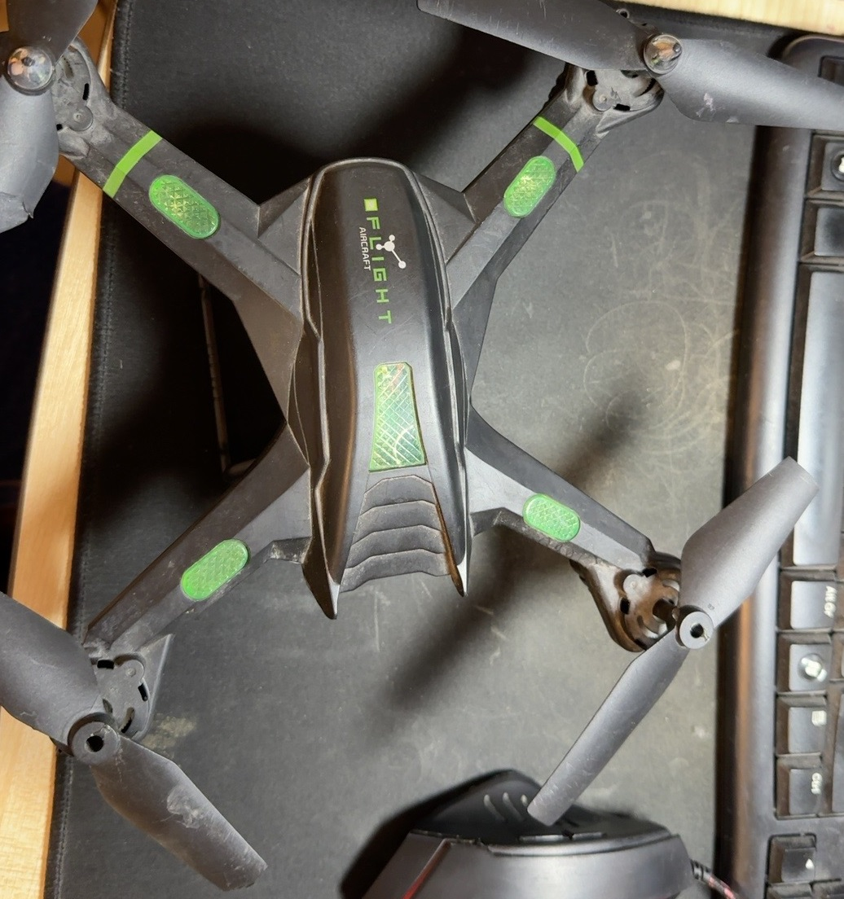
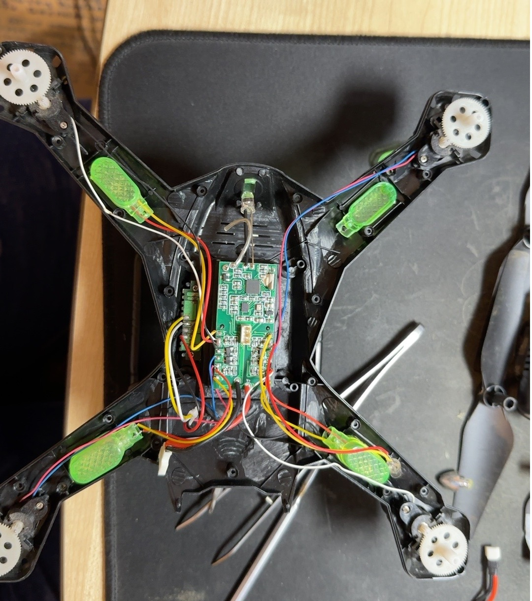
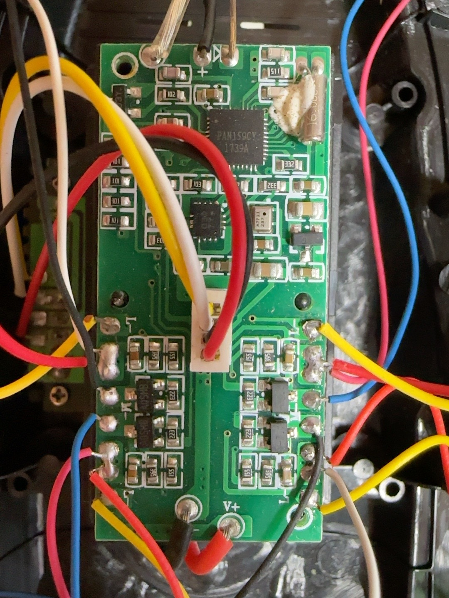
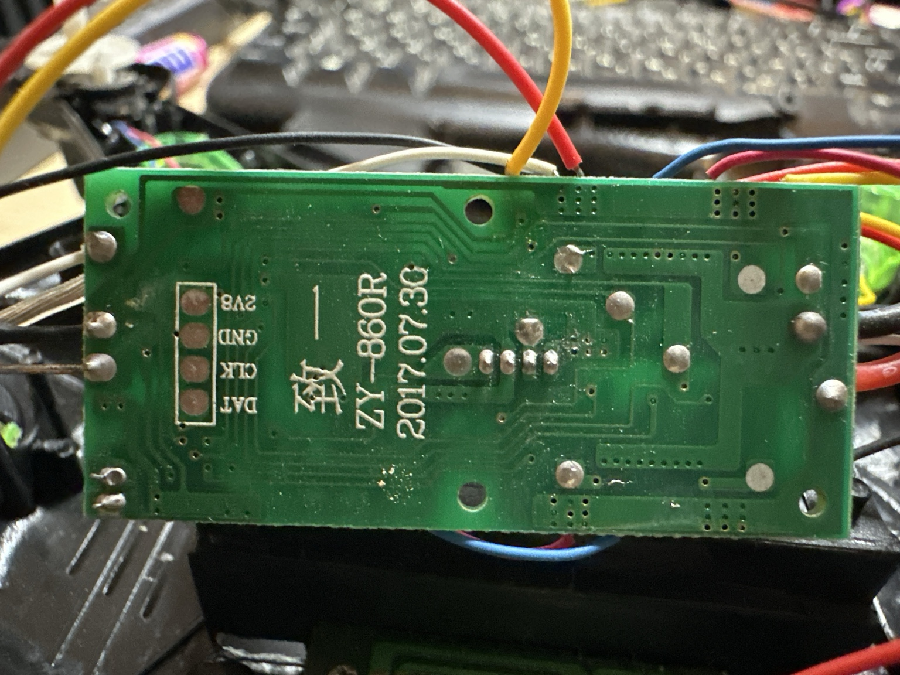
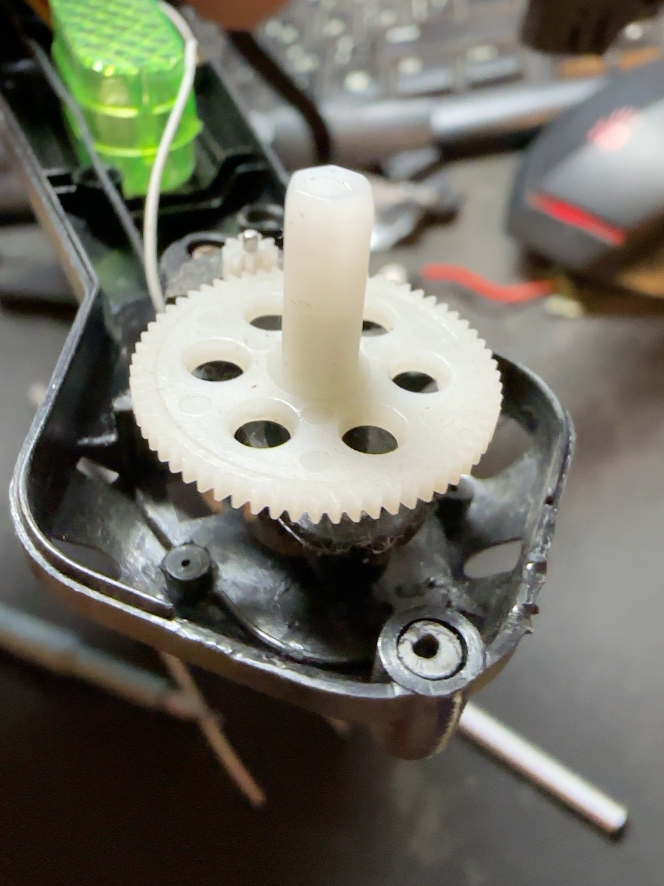
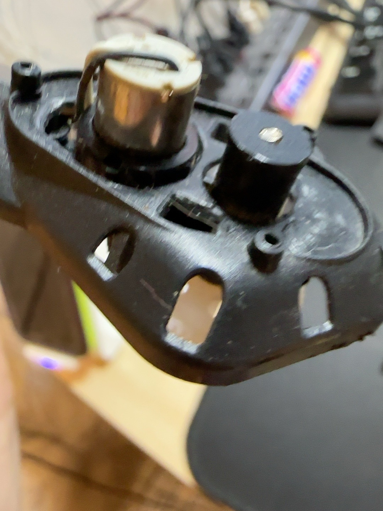
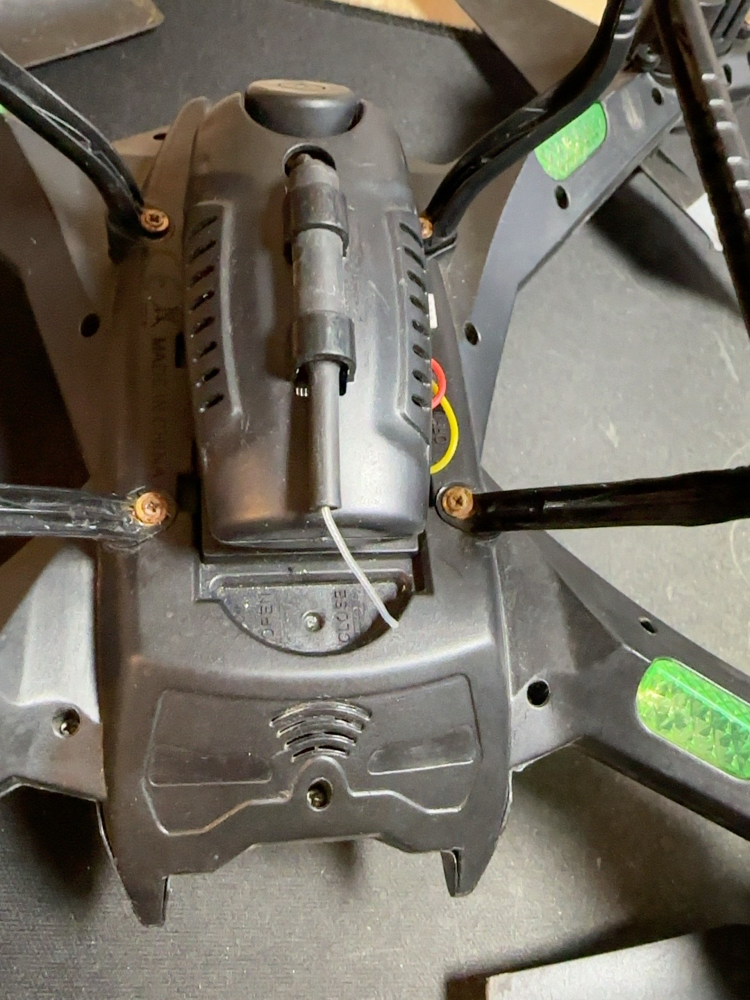
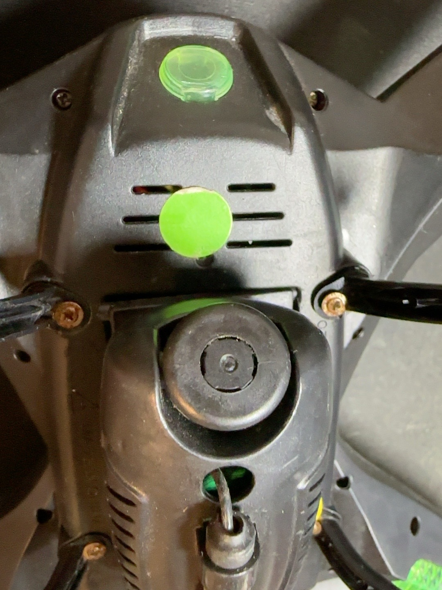
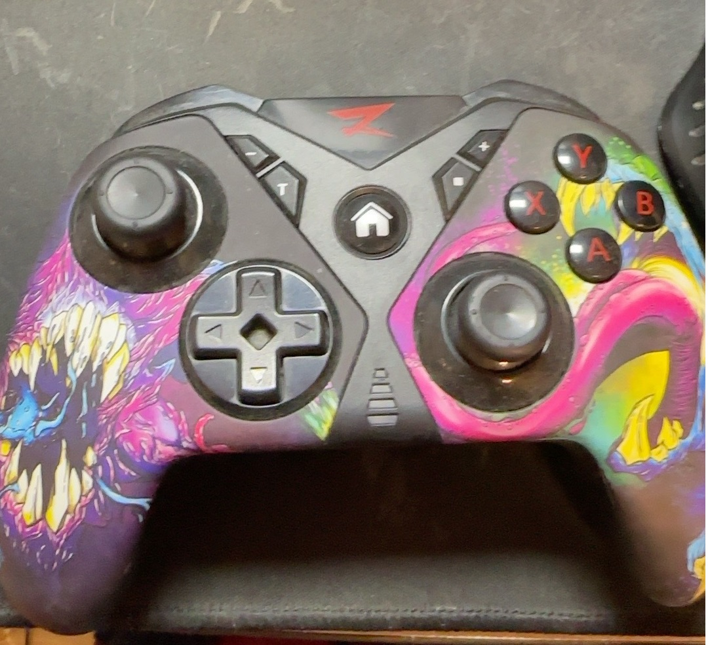

# Фотодневник iQuadro — разборка и восстановление

Дата разбора: **7 ноября 2026 года**. Автор фотографий — разработчик GoSHa / iXimik.

## Опубликованные фотографии: 9 из текущего комплекта

Девять снимков действительно доступны в GitHub-каталоге [`photos/`](../photos/). Миниатюры кликабельны и открывают оригинальные файлы. Анализ ниже основан на реально видимых узлах, а не на догадках о модели дрона.

| Снимок | Техническое описание |
|---|---|
|  [`IMG_35D501A4-B1B3-41E5-A8DD-DAFEC59E4285.jpeg`](../photos/IMG_35D501A4-B1B3-41E5-A8DD-DAFEC59E4285.jpeg) | **Общий вид.** Четыре луча, складные винты, корпус FLIGHT AIRCRAFT. Базовая механика для восстановления. |
|  [`IMG_5053DC6C-4EBA-4EB8-9C8C-45F61891FB48.jpeg`](../photos/IMG_5053DC6C-4EBA-4EB8-9C8C-45F61891FB48.jpeg) | **Рама изнутри.** После снятия крышки видны центральная плата, разводка проводов к четырём моторам и световым модулям. |
|  [`IMG_515EA5BB-3013-4549-9DA4-D03C2ADAA7AC.jpeg`](../photos/IMG_515EA5BB-3013-4549-9DA4-D03C2ADAA7AC.jpeg) | **Плата, компоненты.** Основной контроллер с маркировкой, похожей на PAN159CY, мелкие ИС, обвязка и ключи приводов. |
|  [`IMG_17924557-92C3-48B4-9EEA-6DB59E198053.jpeg`](../photos/IMG_17924557-92C3-48B4-9EEA-6DB59E198053.jpeg) | **Плата, обратная сторона.** Шелкография ZY-860R / 2017.07.30; площадки 2V8, GND, CLK, DAT. Их назначение ещё не установлено. |
|  [`IMG_02CBCBBE-4A2F-4E1B-B041-E95590F19EB7.jpeg`](../photos/IMG_02CBCBBE-4A2F-4E1B-B041-E95590F19EB7.jpeg) | **Редуктор.** Большая пластиковая ведомая шестерня и вертикальный вал под пропеллер; механический привод не прямой. |
|  [`IMG_E6E28FBB-F059-4CB0-B70B-737EDC44C33B.jpeg`](../photos/IMG_E6E28FBB-F059-4CB0-B70B-737EDC44C33B.jpeg) | **Двигатель.** Небольшой цилиндрический щёточный мотор и узел привода в посадочном гнезде одного из лучей. |
|  [`IMG_0BC5C7FA-C769-46C5-8D17-5FE379E5C843.jpeg`](../photos/IMG_0BC5C7FA-C769-46C5-8D17-5FE379E5C843.jpeg) | **Нижний модуль.** Центральный модуль снизу: откидная часть и провод; функциональное назначение отдельных деталей требует уточнения. |
|  [`IMG_A3643001-F41B-417B-A3D1-089BB976A80C.jpeg`](../photos/IMG_A3643001-F41B-417B-A3D1-089BB976A80C.jpeg) | **Модуль крупно.** Круглый элемент в центральном модуле и отдельный провод; не подключать к ESP32 без проверки распиновки. |
|  [`IMG_A3A11BE3-7CC6-438B-9D95-10409D0E0C08.jpg`](../photos/IMG_A3A11BE3-7CC6-438B-9D95-10409D0E0C08.jpg) | **Наш геймпад.** ARDOR GAMING Vigour — подтверждённое Bluetooth-соединение с ESP32 в режиме Nintendo / Switch Pro. |

## Основные выводы по серии

**1. Механика.** Четыре двигательных отсека на концах лучей, вал пропеллера через пластиковую шестерню. Коллекторные моторы и редукторы следует проверить отдельно; фотография не доказывает электрическую исправность.

**2. Электроника.** Плата с нанесённой маркировкой `ZY-860R / 2017.07.30`. На передней стороне виден многовыводный чип (маркировка ранее прочитана как `PAN159CY`), другая малая микросхема и группы обвязки/ключей для моторов. Чип IMU ещё не идентифицирован достоверно.

**3. Контакты.** На тыльной стороне видны надписи `2V8`, `GND`, `CLK`, `DAT`. Сходство с отладочным интерфейсом не доказывает функции площадок. Не подключать к GPIO ESP32 или источнику 3,3/5 В до проверки.

**4. Центральный модуль.** Снизу есть крепление, откидной элемент, круглые детали и провод. По фото нельзя достоверно определить распиновку и назначение каждого элемента. Наличие трёхконтактного CAM-разъёма на другой фотографии не означает, что это зарядный разъём.

**5. Пульт.** ARDOR GAMING Vigour действительно существует в аппаратной сборке проекта; в режиме Nintendo/Switch Pro его оси и кнопки уже считывались Bluepad32. Это **успех Bluetooth-этапа**, не подтверждение радиоуправления квадрокоптером.

## Остальные кадры из полного фотодневника

Следующие оригинальные фотографии обсуждались в процессе ремонта, но **их нет среди девяти опубликованных файлов** текущей папки `photos/`. Не вставляем битые ссылки в галерею; когда кадры будут добавлены, пометим их как опубликованные.

| Имя файла | Содержание |
|---|---|
| `IMG_3D691216-3AFE-4685-AF9B-DD8BF2181871.jpeg` | Корпус снизу, другая общая фотография |
| `IMG_DED6D7B9-103E-4C6F-B56F-49DCA63522A0.jpeg` | Трёхконтактный разъём CAM |
| `IMG_6776ED63-22F3-45FA-A225-C7C6C884C898.jpeg` | Старая Li-Po 802540H, 600 мА·ч |
| `IMG_3BED958E-0273-4AF6-9242-BDEEFF3B55F4.jpeg` | Белый двухконтактный разъём батареи |
| `IMG_5ACEC66E-4A8A-46CB-9DB6-18B7D4CAC56F.jpeg` | Снятая плата защиты аккумулятора |
| `IMG_0683C4F9-E28D-48B4-B8F8-082A97176B05.jpeg` | Крупный план коннектора |
| `IMG_6C6BC9DD-27FE-4660-941E-F70F49BF9F5A.jpeg` | RFID RC522, не подходит для управления дроном |
| `IMG_B0095516-4E31-460C-AE86-12F7CD18C640.jpeg` | UART Bluetooth-модуль |
| `image(20261107-125622).png` | ESP32 на COM3 через CP210x |
| `IMG_E15B2CEF-5898-416D-AD65-65B09B66723B.jpeg` | Наклейка и режимы ARDOR Vigour |

Отдельно встречались рекламные изображения аккумуляторов `IMG_6147.jpeg`, `IMG_6148.jpeg`, `IMG_6149.jpeg` (типоразмеры 903052 / 802540). Это **не авторские фотографии оборудования**, поэтому их не следует без разрешения правообладателей добавлять в публичную галерею.

## Безопасность при дальнейших опытах

Бывшая батарея Li-Po 1S на 600 мА·ч показала **0,18 В** и была, по сообщению владельца, вздута; она утилизирована. Не пытаться заряжать её. Для диагностики штатной платы использовать регулируемый источник 3,7 В с ограничением тока, строго проверив полярность. **Все пропеллеры снять, а силовую цепь не проводить через breadboard или ESP32.**

**GoSHa:** «Фотоотчёт доказал, что в нашей лаборатории есть четыре редуктора, куча проводов и работающий джойстик. Отсутствие полёта пока считаем особенностью ранней версии».

[К началу README](../README.md) · [Аппаратная часть](HARDWARE.md) · [Тесты геймпадов](GAMEPAD_TESTS.md)
